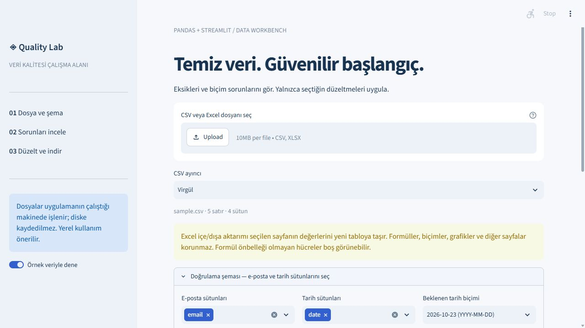

# Data Quality Workbench

Python + pandas + Streamlit application for inspecting CSV/XLSX data, choosing
corrections and exporting a new clean table. Turkish UI with schema controls,
issue report and live correction preview.



## Run
Python 3.12+:
```sh
python -m venv .venv
# Windows: .venv\Scripts\activate
# macOS/Linux: source .venv/bin/activate
python -m pip install -r requirements.txt
python -m streamlit run app.py
```
Open http://localhost:8501. Enable the sample-data toggle to try the included
synthetic fixture, then select `email` and `date` in the validation schema.

## Workflow
1. Upload UTF-8 CSV or XLSX; choose delimiter or worksheet.
2. Select email/date columns and an explicit date format.
3. Inspect missing cells, exact duplicate rows and invalid formats.
4. Select trimming, duplicate removal, missing-value filling and/or date normalization.
5. Inspect the preview and download CSV/XLSX or the issue report.

Source files are never overwritten. No corrections are selected by default.
Dates are calendar-validated with exact formats; ambiguous dates are not guessed.
Email validation checks syntax only, not whether the address exists.
Duplicate removal runs after the other selected corrections and retains the first row.

## Data contract
- Maximum 10 MB, 50,000 data rows, 150 columns; first row is a unique nonempty header.
- CSV delimiter is explicit (comma, semicolon or tab); inconsistent row widths fail.
- CSV strings retain leading zeros and literal `NA` values.
- XLSX is **values-only, one selected sheet**. Styles, formulas, other sheets,
  charts and macros are not preserved. Formula results require an existing Excel cache.
- Exported XLSX is a new text-cell table. Formula-like CSV values/headers are
  prefixed with an apostrophe to avoid spreadsheet formula execution.
- Uploads live in the app process/session, not on disk. The server operator can
  access them; this project binds to localhost for personal use.

## Tests
```sh
python -m pytest -q
```
Tests cover missing values, duplicates, exact dates, leading zeros, selective
corrections, source immutability, CSV/XLSX round trips, safe export, and a Streamlit
sample workflow. `quality.py` contains the pure processing functions.

## References
[pandas read_excel](https://pandas.pydata.org/docs/reference/api/pandas.read_excel.html)
and [openpyxl workbook limitations](https://openpyxl.readthedocs.io/en/3.1/tutorial.html).
